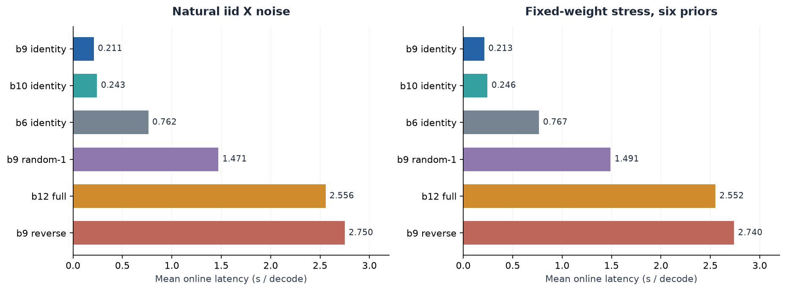
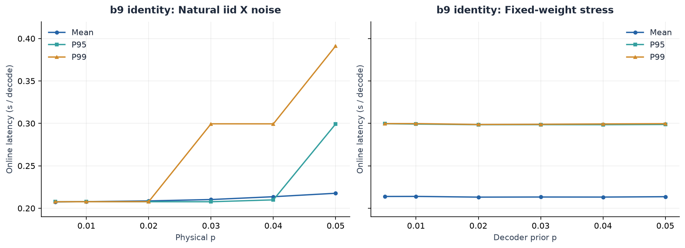
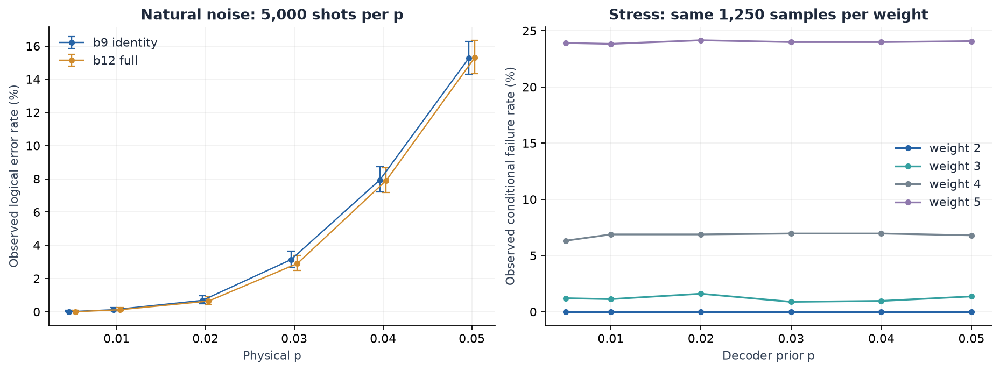
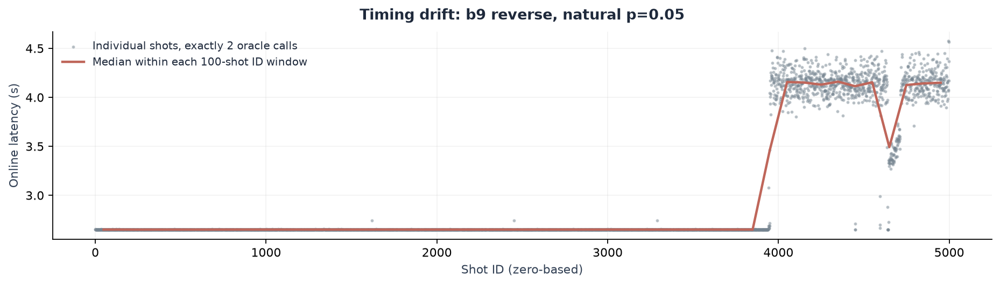

# BB72 多 syndrome 验证结果分析报告

分析日期：2026-09-23。实验记录覆盖 2026-09-19 至 2026-09-22（新加坡时间）。

数据来源：`exact_bnb/v0_5_multisyndrome_validation` 下 7 个 SQLite 数据库、14 个 CSV、7 组运行清单与冻结数据集，以及两份作业日志。报告以逐 shot 数据库重算为准。

**结果已经完整；b9 identity 的速度优势在此次多 syndrome 验证中保持成立。数值正确性应保留限定：扇区选择存在少量差异，低先验概率压力测试也没有全部通过原来的 1e-10 概率一致性阈值。**

- 预期和实际均为 **360,000 次解码**，72 个 `(layout, dataset)` 组合各 5,000 条，未发现缺失、重复或汇总失配。
- 自然噪声下 b9 identity 平均 **0.2109 s/shot**，相对 b12 完整后验基准快 **12.12 倍**；压力测试下为 **0.2135 s/shot**，快 **11.95 倍**。
- b9 在全部 12 个数据条件下均为平均耗时最低的已测布局。自然噪声的平均 oracle 调用为 **2.0359**，压力测试为 **2.0667**。
- b9 与 b12 的扇区差异分别为 **103/30,000**（自然噪声）和 **271/30,000**（压力测试）。b9 的概率一致性阈值超限分别为 **0** 和 **125** 条。
- 全部 5 个候选布局对 b12 的 300,000 次配对比较，共 **1,860** 次扇区差异、**635** 次概率差超过 1e-10。两种计数有重叠，均不是独立物理样本数。

## 1. 实验范围与完整性

码与通道：BB72 `[[72,12,6]]`，独立 X 错误，用 H_Z 和 logical-Z observables 进行解码。日志记录设备为 **NVIDIA A100-SXM4-40GB**，单 GPU，Torch 2.10.0+cu128，cuTensorNet，float64。这里测到的是 A100 性能。

共验证 6 个布局：b9 identity（9+3）、b10 identity（10+2）、b6 identity（6+6）、b12 full（12）、b9 random-1（9+3 的另一种逻辑划分）、b9 reverse（9+3 的反向逻辑顺序）。报告中的简称对应原始 `stageA-*` / `stageB-*` 标签。

| 数据组 | 预期解码数 | 实际解码数 | 状态 | 在线耗时之和（h） |
| --- | --- | --- | --- | --- |
| Part A：自然噪声，6 个 p | 180,000 | 180,000 | 完整 | 66.60 |
| Part B：压力，p=0.005 | 30,000 | 30,000 | 完整 | 11.12 |
| Part B：压力，p=0.01 | 30,000 | 30,000 | 完整 | 11.12 |
| Part B：压力，p=0.02 | 30,000 | 30,000 | 完整 | 11.12 |
| Part B：压力，p=0.03 | 30,000 | 30,000 | 完整 | 11.12 |
| Part B：压力，p=0.04 | 30,000 | 30,000 | 完整 | 11.13 |
| Part B：压力，p=0.05 | 30,000 | 30,000 | 完整 | 11.14 |

检查包括 SQLite `integrity_check`、主键唯一性、每组 shot_id 精确覆盖 0–4999、数值有限性、耗时/概率范围、冻结数据的 shape 与权重，以及数据库的 true_lambda、错误权重、syndrome 权重与 NPZ 逐条一致。`logical_success` 与 `best_lambda == true_lambda` 一致；每条记录均满足叶节点记账合计 4096、拓扑调用数合计等于 oracle_calls。14 个已有 CSV 的全部指标均与数据库重算结果一致。

上述检查核验了已有结果之间的一致性。本次没有重新在 GPU 上收缩张量网络，也没有重新构造 H_Z/L_Z 来独立验证冻结文件中的 syndrome 映射。

**样本数应按实验设计解释：** Part A 是 6×5,000=30,000 次自然噪声抽样，每个样本给 6 个布局解码。Part B 是同一批 5,000 次固定权重抽样，在 6 个解码先验下分别给 6 个布局解码。本次核对了全部数组，6 个压力数据集的 errors、syndromes、true_lambdas 和权重完全相同。因此总计是 35,000 次原始抽样、60,000 个“样本与先验组合”、360,000 次布局解码，不能当作 360,000 个独立噪声样本。

README 描述的是只运行一个压力先验时每布局 35,000 次解码；本目录的 PBS 实际扩展到了 6 个压力先验，因此是每布局 60,000 次。Part A 的空 stress 文件与 Part B 的空 natural 文件对应 shots=0，是正常产物。

## 2. 耗时与布局选择

以下耗时是数据库中的 `wall_seconds`：从 `ExactBlockBnB.search()` 开始到输出最优逻辑扇区，包含同步 oracle 调用和搜索控制。路径搜索、decoder 构造、warm-up、search 之前的输入转换、SQLite 提交和汇总输出不在此指标内。`oracle_seconds` 还包括调用包装与同步，不能当作纯 GPU kernel 时间。

### 各布局的总体性能

| 布局 | 自然平均 s | 自然 P99 s | 压力平均 s | 压力 P99 s | 自然对 b12 加速 | 60,000 次在线 h |
| --- | --- | --- | --- | --- | --- | --- |
| b9 identity | 0.2109 | 0.2994 | 0.2135 | 0.2997 | 12.12× | 3.54 |
| b10 identity | 0.2426 | 0.3386 | 0.2456 | 0.3394 | 10.53× | 4.07 |
| b6 identity | 0.7620 | 1.0228 | 0.7673 | 1.0241 | 3.35× | 12.74 |
| b9 random-1 | 1.4711 | 2.0347 | 1.4908 | 2.0385 | 1.74× | 24.68 |
| b12 full | 2.5557 | 2.5603 | 2.5520 | 2.5587 | 1.00× | 42.56 |
| b9 reverse | 2.7495 | 4.3055 | 2.7398 | 4.1689 | 0.93× | 45.74 |

自然与压力各有 30,000 次解码/布局，汇总均按真实 shot 加权；此处各 p 的样本数相同。压力汇总用于描述本次工作负载的耗时，不能据此计算 30,000 个独立样本的误差条。

b9 identity 相对 b10 identity 的平均时间减少 **13.1%**（自然）和 **13.1%**（压力）。b10 虽然调用次数稍少，单次收缩和根块输出的代价更高。b9 random-1 与 reverse 的调用数也与 identity 接近，但自然平均耗时分别是它的 **6.98 倍**和 **13.04 倍**。因此，优化目标需要同时考虑块划分对应的收缩成本和实际存活前缀数，不能只按 query 数排序。

原 P5.1 在 easy/hard 两个 syndrome 上给出的 b9 平均为 0.3005 s，此次自然总体均值更低。这反映样本难度分布不同，不能把两者的差值解释为新的代码提速。

### b9 identity 随 p 的性能

| p | 自然平均 s | 自然 P99 s | 自然平均调用 | 压力平均 s | 压力 P99 s | 压力平均调用 |
| --- | --- | --- | --- | --- | --- | --- |
| 0.005 | 0.2075 | 0.2076 | 2.0000 | 0.2139 | 0.2997 | 2.0652 |
| 0.01 | 0.2078 | 0.2077 | 2.0016 | 0.2139 | 0.2998 | 2.0668 |
| 0.02 | 0.2086 | 0.2078 | 2.0104 | 0.2131 | 0.2987 | 2.0670 |
| 0.03 | 0.2103 | 0.2995 | 2.0282 | 0.2132 | 0.2989 | 2.0670 |
| 0.04 | 0.2136 | 0.2994 | 2.0652 | 0.2132 | 0.2993 | 2.0670 |
| 0.05 | 0.2176 | 0.3913 | 2.1100 | 0.2136 | 0.2997 | 2.0670 |

自然 p 从 0.005 到 0.05，b9 平均耗时从 0.2075 s 增至 0.2176 s，仅增约 4.9%，但 P99 从 0.2076 s 增至 0.3913 s。说明高 p 下主要增加了少量困难样本的尾部开销。压力样本固定后，平均耗时约 0.213–0.214 s，对当前先验范围不敏感。

## 3. Query 数与剪枝的实际含义

此实现的一个 oracle call 会返回一整个逻辑块的质量张量。b9 根调用返回 512 个九位前缀质量，随后每个存活前缀的一次调用返回 8 个剩余扇区质量。它与旧 sweep 的“一个 parity mask 一次标量 query”不是同一种工作量。

| 指标 | 自然噪声 b9 | 压力测试 b9 |
| --- | --- | --- |
| 平均 oracle 调用 | 2.0359 | 2.0667 |
| 恰好 2 次调用 | 29,222/30,000（97.41%） | 28,340/30,000（94.47%） |
| 平均第二块存活前缀 N_survive | 1.0359 | 1.0667 |
| 最大调用次数 | 13 | 7 |
| 平均 leaves_evaluated | 1.0217 | 1.0443 |
| oracle 占在线耗时 | 98.95% | 99.04% |

相同 9+3 划分如果不剪枝，完整遍历需要 1+512=513 次块 oracle 调用；当前自然均值 2.0359 次，相对于这种遍历减少约 99.60% 的调用。这个比例只比较相同块 oracle 的调用数，不能等同于 FLOP 减少或端到端加速。

b12 仅需一次调用，但直接形成全部 4096 个扇区质量，其单次收缩明显更贵。`leaves_evaluated` 只计搜索程序实际到访/比较的叶节点，不代表张量收缩实际生成的叶概率数；b12 的该指标接近 1，也仍然计算了完整的 4096 输出。旧 sweep 的 4095 parity queries 与这里约 2 次块调用同样不能直接换算成约 2000 倍提速。

## 4. 与完整后验基准的一致性

`consistency_vs_b12.csv` 使用两个不同判据：`same_lambda` 是选出的 12 位扇区完全相同；`prob_close_1e-10` 是各自归一化最优概率的绝对差不超过 1e-10。这里的 b12 是同一套 float64 TN 实现的完整输出基准，仍会受浮点误差影响。

| 候选布局 | 自然扇区差异 /30k | 压力扇区差异 /30k | 自然概率超限 | 压力概率超限 | 最大概率绝对差 |
| --- | --- | --- | --- | --- | --- |
| b9 identity | 103 | 271 | 0 | 125 | 3.298e-08 |
| b10 identity | 100 | 244 | 0 | 137 | 3.298e-08 |
| b6 identity | 105 | 286 | 0 | 136 | 3.298e-08 |
| b9 random-1 | 102 | 268 | 0 | 122 | 3.301e-08 |
| b9 reverse | 91 | 290 | 1 | 114 | 3.298e-08 |

### b9 的差异集中在哪里

| 类型 | p | 扇区差异 /5000 | 概率超限 /5000 | 最大概率差 | 仅 b9 成功 | 仅 b12 成功 |
| --- | --- | --- | --- | --- | --- | --- |
| 自然 | 0.005 | 0 | 0 | 2.408e-11 | 0 | 0 |
| 自然 | 0.01 | 0 | 0 | 6.954e-12 | 0 | 0 |
| 自然 | 0.02 | 15 | 0 | 9.722e-12 | 6 | 8 |
| 自然 | 0.03 | 20 | 0 | 6.400e-12 | 3 | 15 |
| 自然 | 0.04 | 37 | 0 | 2.649e-12 | 15 | 17 |
| 自然 | 0.05 | 31 | 0 | 1.328e-12 | 11 | 8 |
| 压力 | 0.005 | 77 | 114 | 3.298e-08 | 34 | 35 |
| 压力 | 0.01 | 53 | 11 | 7.649e-10 | 22 | 24 |
| 压力 | 0.02 | 38 | 0 | 4.421e-11 | 13 | 19 |
| 压力 | 0.03 | 37 | 0 | 5.601e-12 | 16 | 14 |
| 压力 | 0.04 | 34 | 0 | 6.938e-13 | 14 | 11 |
| 压力 | 0.05 | 32 | 0 | 6.724e-13 | 9 | 18 |

自然噪声中，b9 的 103 条扇区差异对应的最优概率差最大为 **3.744×10⁻¹³**。所有候选布局的自然扇区差异，其最优概率差最大也只有 4.141×10⁻¹³。这与并列或近似并列最大值受浮点收缩顺序影响的情况相符。代码的 incumbent 更新只用严格的 `mass > best_mass`，没有跨布局统一的容差平局规则。

但数据库只保存最终扇区和该扇区的概率，没有保存完整 posterior、runner-up 概率、候选扇区在同一基准张量下的概率。因此，**不能仅凭两个最优概率接近就证明每一个不同扇区都是合法的并列 MAP 解，也不能把扇区不一致率直接当成算法错误率。**

在低 p 压力数据上，浮点消减问题更明显。635 条概率超限中，581 条来自压力 p=0.005、53 条来自压力 p=0.01，其余 1 条来自自然 p=0.03。它们涉及错误权重 5 的 569 次比较、权重 4 的 65 次比较和权重 7 的 1 次比较。其中 594 次仍然选中了相同扇区，41 次同时发生扇区差异。

### 一个具体复核案例

压力 `p=0.005`、`shot_id=827`（从 0 开始计数），错误权重 5、syndrome 权重 9：

| 项目 | b9 identity | b12 full |
| --- | --- | --- |
| best_lambda | `000000000000` | `001010111000` |
| true_lambda | `001010111000` | `001010111000` |
| best_probability | 0.4997853025536222 | 0.4997852695767487 |
| logical_success | 0 | 1 |
| root_mass | 1258.0145005967775 | 1258.0145856758368 |

这条的最优概率差约 **3.298×10⁻⁸**，有扇区选择差异，也有归一化分母差异。其他几个候选布局同样给出约 0.49978530255 的最优概率，因此不能直接认定 b12 的概率数值更准确，需要在统一收缩/更高精度的结果下交叉求值。

`root_mass` 是带公共 TN 缩放因子的未归一化质量，数值可以大于 1；不能把它直接当作 syndrome 概率。应该比较归一化概率或同一缩放下的相对误差。

### 数值保护是否足够

| 分组 | 出现负质量裁剪的 shot | 最大 |负质量|/root | 最大 local_guard/root |
| --- | --- | --- | --- |
| 自然 b9 | 12,589/30,000 | 1.505e-13 | 2.407e-12 |
| 压力 b9 | 6,532/30,000 | 8.046e-10 | 1.287e-08 |
| 压力 b12 | 10,831/30,000 | 9.253e-09 | 1.480e-07 |

负值的绝对大小依赖 TN 缩放，相对 root 的比例更有解释力。出现裁剪本身不等于解码失败。当前程序在负质量超过 root 的 1e-6 时才中止；本次没有触发中止。可是“没有中止”并不等于通过了 1e-10 的跨布局概率一致性检查。

代码按已观察到的负质量量级构造剪枝保护项，这是实际数值防护；它没有为所有正质量收缩误差提供严格上界。因此，现有结果支持“数值上高度接近、速度优势稳定”，尚不能作为对全部浮点剪枝决策的严格精度证明。

## 5. 逻辑解码成功率

这里的 `logical_success=1` 定义为预测逻辑扇区 `best_lambda` 等于冻结物理错误对应的 `true_lambda`。它表示这次样本的逻辑解码成功，和任务是否完整、是否与 b12 一致是三个不同指标。即使精确 MAP 解码，也可能对某次实际错误解码失败。

### 自然噪声 LER

以下每行各有 5,000 个自然噪声样本。95% 区间采用逐 p 的二项 Wilson 区间；没有将不同 p 或不同布局混合成独立试验。

| p | b9 失败数 | b9 LER | b9 95% 区间 | b12 失败数 | b12 LER |
| --- | --- | --- | --- | --- | --- |
| 0.005 | 0 | 0.00% | 0.000%–0.077% | 0 | 0.00% |
| 0.01 | 6 | 0.12% | 0.055%–0.262% | 6 | 0.12% |
| 0.02 | 34 | 0.68% | 0.487%–0.949% | 32 | 0.64% |
| 0.03 | 157 | 3.14% | 2.691%–3.661% | 145 | 2.90% |
| 0.04 | 397 | 7.94% | 7.222%–8.722% | 395 | 7.90% |
| 0.05 | 763 | 15.26% | 14.290%–16.283% | 766 | 15.32% |

p=0.005 的 0/5,000 是“未观察到失败”，并非证明真实 LER 为零；Wilson 95% 上界约为 0.0768%。自然样本总计 b9 比 b12 多 13 次失败，配对分解为 35 次仅 b9 成功、48 次仅 b12 成功。由于这些差异集中在近似平局样本，现阶段不能据此断言一种布局的物理纠错能力更好。

### 压力数据按错误权重分层

固定权重数据中，p 只表示解码器使用的独立噪声先验，实际样本始终按权重 2、3、4、5 各 1,250 个构成。这里报告的是该压力分布上的条件失败率，不能当作自然噪声 LER 曲线。

| 解码先验 p | 权重 2 | 权重 3 | 权重 4 | 权重 5 |
| --- | --- | --- | --- | --- |
| 0.005 | 0/1250（0.00%） | 15/1250（1.20%） | 79/1250（6.32%） | 299/1250（23.92%） |
| 0.01 | 0/1250（0.00%） | 14/1250（1.12%） | 86/1250（6.88%） | 298/1250（23.84%） |
| 0.02 | 0/1250（0.00%） | 20/1250（1.60%） | 86/1250（6.88%） | 302/1250（24.16%） |
| 0.03 | 0/1250（0.00%） | 11/1250（0.88%） | 87/1250（6.96%） | 300/1250（24.00%） |
| 0.04 | 0/1250（0.00%） | 12/1250（0.96%） | 87/1250（6.96%） | 300/1250（24.00%） |
| 0.05 | 0/1250（0.00%） | 17/1250（1.36%） | 85/1250（6.80%） | 301/1250（24.08%） |

权重 2 在所有先验下均未观察到失败。权重 5 的失败率约 24%，是压力失败的主要来源。先验从 0.005 调到 0.05 后，耗时和条件失败率变化都较小；由于重复使用同一批样本，且平局选择尚未统一，不宜按这些微小波动选择“最优先验”。

## 6. 耗时异常与资源账目

自然 `p=0.05` 的 b9 reverse 有一段额外变慢。限定 oracle_calls 恰好为 2，shot_id 0–999 的平均耗时为 **2.6503 s**，而 4000–4999 为 **4.0810 s**。调用次数未增加仍然变慢，说明这部分不能由 BnB 扩展更多前缀来解释。

现有日志没有 GPU 利用率、频率、温度、其他作业占用等时间序列，无法据此确定外部负载或硬件状态是否是原因。本报告保留全部观测值，没有删除慢样本。该现象需要在比较尾延迟或进行更细的布局竞速时单独复测。

全部逐 shot 在线时间之和为 **133.34 GPU·h**（单 GPU 时间口径），其中自然约 66.60 h、压力约 66.74 h。这不等同于 PBS 计费时间，初始化、提交、空闲和中断间隔不在其中。Part A 日志从 9 月 19 日 10:08:19 到 9 月 22 日 04:48:54，约 66.68 h；Part B 当前日志从中途续跑开始，前面若干组直接 skip，因此不能拿这份日志的首尾差当作全部 Part B 耗时。

仅 b9 identity 的 60,000 次在线解码共 **3.54 h**。若后续只跑已测最优布局，相同规模的已记录在线工作量会远少于本次六布局验证；这是基于本次相同数据条件的工作量估计，不包含新增运行的系统开销，也不是新 syndrome 分布的保证。

## 7. 建议的后续验证

1. **保留 b9 identity 作为性能基线，优先复核差异样本。** 先检查低 p 压力 shot 827 及其他概率超限/扇区差异样本，无需马上重跑完整 360,000 次验证。报告目录的差异清单保留 run、布局、dataset、shot_id、概率与扇区，原始错误和 syndrome 可由 NPZ 定位。
2. **在同一 b12 posterior 下评价候选扇区。** 对差异样本保存 P_ref(lambda_b9)、P_ref(lambda_b12)、top-2 gap、归一化残差和 root 质量差，区分并列最优、数值归一化差异和真正次优解。必要时用另一条收缩路径或更高精度交叉校验。当前 `best_probability` 的接近只能作为线索。
3. **统一平局规则后再比较逐 shot 成功率。** 明确绝对/相对容差与固定的扇区排序，记录候选最优集合；只修改平局裁决不能消除正质量误差，需要先完成上述交叉评价。不要仅放宽 1e-10 阈值来宣称“完全通过”。
4. **若继续性能优化，先测每种拓扑的单次成本。** b9 当前约 99% 的在线时间仍在 oracle 包装调用内。应分别记录根块与第二块耗时、存活前缀数和 GPU 状态，同时复测 reverse 的时段漂移。进一步减少 query 的收益应按总时间评估。

从当前记录可得出的明确结论是：**b9 identity 的速度优胜已在此多样本工作负载上重现；完整性合格；严格逐扇区一致性与低 p 压力数值精度仍需针对差异样本补验证。**

## 8. 复核依据与附件

- 逐 shot 来源：7 个 `validation_*/results.sqlite` 的 `shots` 和 `layout_meta` 表。每个 shot 的 `wall_seconds`、`oracle_seconds`、`oracle_calls`、成功标志和数值诊断都在数据库中。
- 设置和样本：各目录的 `run_manifest.json`、`datasets/dataset_manifest.json`、`datasets/*.npz`。基础随机种子为 20260919。
- 指标定义：[validation_utils.py](../validation_utils.py) 中 `write_summaries` 与建表定义；[run_bb72_multisyndrome_validation.py](../run_bb72_multisyndrome_validation.py) 中 `decode_once`、success 计算与逐 shot 写入；[exact_block_bnb.py](../exact_block_bnb.py) 中 `search`、`_dfs`、`_sanitize`、`_update_incumbent`；[multi_logical_tensor_network_decoder.py](../multi_logical_tensor_network_decoder.py) 的未归一化质量说明。
- 执行记录：[Part A 日志](../output-partA-natural.txt)、[Part B 日志](../output-partB-stress.txt)。数据库 `created_at` 使用 SQLite UTC，报告中的日历时间已按新加坡 UTC+8 解读。
- [重算指标与概率超限明细](audit_metrics.json)：含输入数据库 SHA-256、完整性结果、72 组统计与全部 635 条概率超限比较。
- [扇区差异明细](sector_mismatches.json)：全部 1,860 条候选布局与 b12 的扇区差异比较，可按 run、tag、dataset_name、shot_id 精确定位。

本次只读取原始结果与代码，并在独立的 `analysis_20260923` 目录生成分析产物；没有更改原始运行代码、数据库或 CSV。
